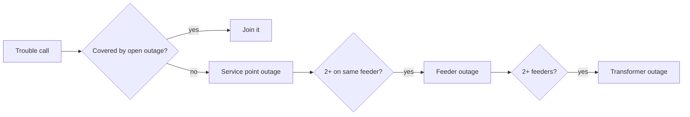

# Outage Prediction Engine

A C++ engine that turns customer trouble calls into predicted power outages on a low-voltage distribution network: the core logic of an Outage Management System (OMS).

Built during my internship at ITEN Engineering, using **C++17**, **SQLite** and **GoogleTest**.

## How it works

Customers only know that their power is out, not why. The engine finds the most likely cause by looking at where the calls come from:

- one house without power → outage on its **service point** (connection)
- 2+ service points on the same feeder → merged into one **feeder** outage
- 2+ feeders → merged into one **transformer** outage

New calls join an existing outage when one already covers them, so the dispatcher sees a few predicted outages instead of dozens of separate calls.



## Features

- Outage prediction with automatic roll-up
- Confirming and restoring outages (dispatcher actions)
- Emergency alerts for hazard calls
- Network view with open outages marked
- Calls and outages saved to SQLite and restored on restart
- Unit tests for the network, the engine and the menu

## Getting started

**Requirements:** `g++` (C++17), `make`, SQLite 3, GoogleTest (for tests).
On Windows with MSYS2 (UCRT64):

```
pacman -S mingw-w64-ucrt-x86_64-gcc make mingw-w64-ucrt-x86_64-sqlite3 mingw-w64-ucrt-x86_64-gtest
```

**Create the database** (schema plus a sample network of 4 feeders and 31 customers):

```
sqlite3 db/outage-prediction.db < db/outage-prediction.sql
```

**Build and run:**

```
make
./outage_predictor
```

**Run tests:**

```
make test
```

## Try it

Report two calls from different houses on the same feeder, for example delivery points **1001** and **1002**. The first creates an outage on its service point; the second triggers a roll-up, and both are merged into one outage on **Feeder 1**. *Show network* marks the feeder with the new outage.

## Project structure

```
src/     engine, network, database, menu and entity classes
tests/   GoogleTest suites
db/      SQL script for the database
```
